<p align="center"></p>

<h1 align="center">Forkcast</h1>

<p align="center"><b>Your meals for the day, already picked from Swiggy.</b></p>

<p align="center">
Built on the <a href="https://mcp.swiggy.com/builders">Swiggy MCP</a> ·
Dry run by default · Allergy-safe · Learns from you
</p>

Forkcast is a daily meal recommender built on the Swiggy MCP. Every morning it lays out
breakfast, lunch, an evening snack and dinner: real dishes from restaurants that deliver
to you, plus small Instamart add-ons that cover what your day is missing. It stays inside
your monthly food budget, follows your diet, keeps your allergies off the plate, reacts to
the weather, and learns from what you order, like and skip.

You stay in charge of ordering. Out of the box Forkcast runs in **Cart only** mode (a dry
run): **Add to cart** puts the meal in your real Swiggy cart and you check out on Swiggy.
Switch to **Real orders** and one tap shows what Swiggy will charge, a second tap places it.

> **Status:** working prototype against the live Swiggy Food and Instamart MCP servers.
> Built by **Vardan Agarwal** and **Jatin Tilwani**.
> Production access application: [`docs/PRODUCTION-APPLICATION.md`](docs/PRODUCTION-APPLICATION.md) ·
> Hosting: [`docs/DEPLOY-HF.md`](docs/DEPLOY-HF.md) (chosen: Hugging Face Space + Vercel + UptimeRobot).
> Alternatives: [`docs/DEPLOY.md`](docs/DEPLOY.md) (Oracle Cloud VM), [`docs/DEPLOY-GCP.md`](docs/DEPLOY-GCP.md) (Google Cloud).

---

## Screenshots

| Today (light) | Today (dark) |
|---|---|
| 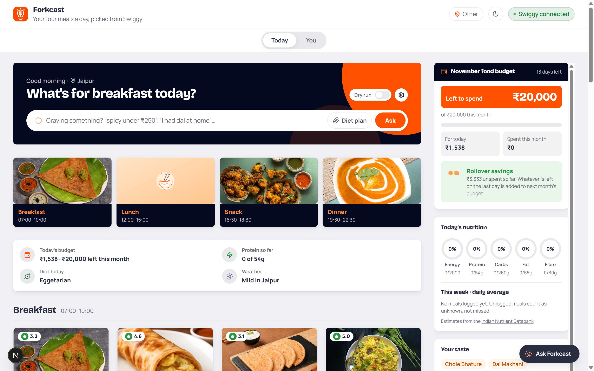 | 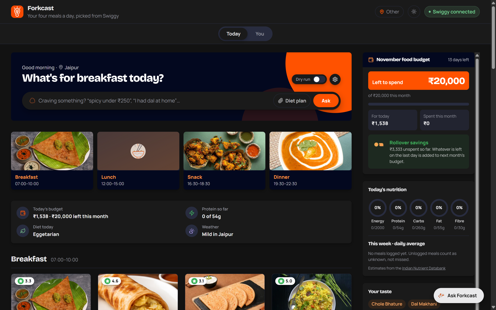 |

| Meal cards with roles | Ask Forkcast |
|---|---|
| 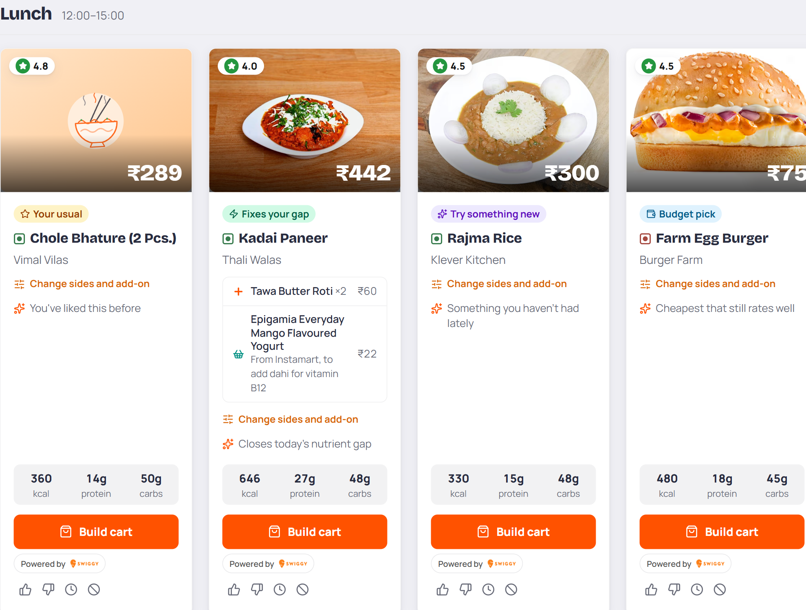 | 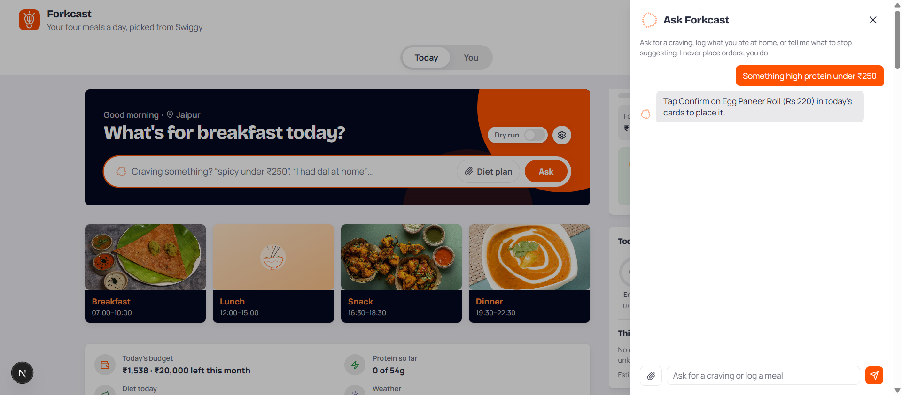 |

| You tab: taste profile | Meal times and reminders |
|---|---|
| 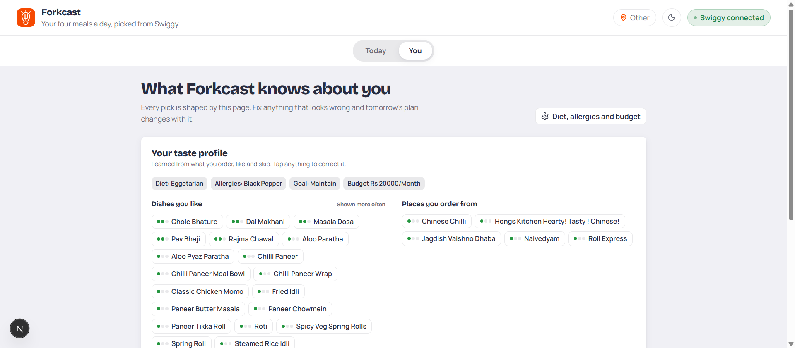 | 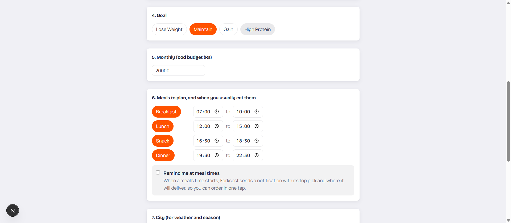 |

<p align="center">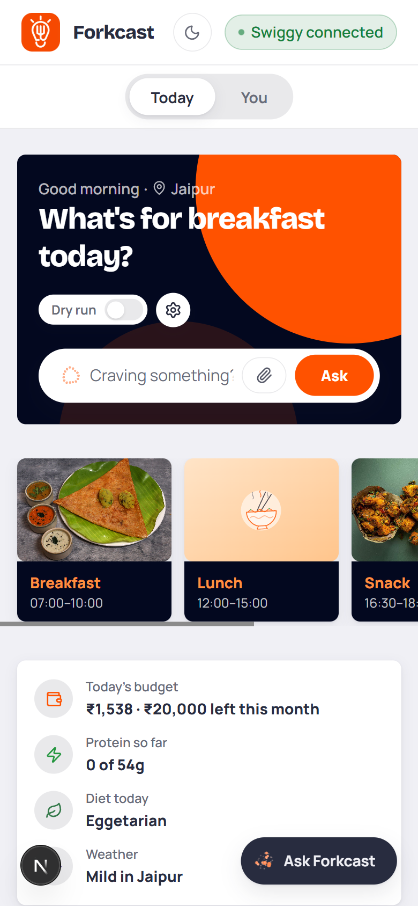</p>

---

## Contents
- [How it works](#how-it-works)
- [Features](#features)
- [Customise a card](#customise-a-card)
- [Meal-time reminders flow](#meal-time-reminders-flow)
- [Ordering safety](#ordering-safety)
- [Architecture](#architecture)
- [Tech stack](#tech-stack)
- [Run it locally](#run-it-locally)
- [Deploy](#deploy)
- [Configuration](#configuration)
- [API routes](#api-routes)
- [Data model](#data-model)
- [Tests](#tests)
- [Security and privacy](#security-and-privacy)
- [Repository map](#repository-map)
- [Known limits](#known-limits)
- [Team](#team)
- [Credits](#credits)

---

## How it works

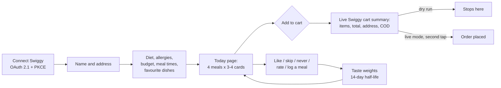

1. **Set up once.** Connect Swiggy on Swiggy's own sign-in page, pick a saved address, then
   set diet, allergies, goal, monthly budget, meal windows and a few dishes you like.
2. **Every day.** A nightly job builds the next day's plan. The Today page shows four meals,
   each with three or four cards that each have a job (your usual, fixes your gap, try
   something new, budget pick).
3. **Order or not.** Tap **Add to cart** and the meal is in your Swiggy cart, ready to check
   out on Swiggy. The card shows **In your Swiggy cart**, and any other card of that meal can
   **Swap into cart** instead. In **Real orders** mode the button is **Order now**, and a placed
   order closes the meal.
4. **Feedback.** Every like, skip, "never", rating and order changes tomorrow's plan.

---

## Features

### Four meals a day, each pick with a job
Every meal shows three or four cards, and each card has a role:

| Role | What it means |
|---|---|
| **Your usual** | Something you've ordered or liked before |
| **Fixes your gap** | Closes the nutrient you're shortest on today (protein, iron, calcium…) |
| **Try something new** | A dish you haven't had in the last two weeks |
| **Budget pick** | The cheapest option that still rates well |

Where: `ROLES` and the per-role picker in `backend/daily.py`; cards render in
`web/src/components/daily/TodayView.tsx`.

A restaurant appears at most once a day, and the same dish never shows up twice, even
under a different name ("Kadchi Plain Rajma-Chawal" and "Rajma Chawal" count as one).

### Real meals, not menu items
Each dish name is classified once (meal, curry, bread, rice, side, snack, sweet, drink)
and the result is stored, so the rules read what a dish *is* instead of guessing from words.

- A curry always arrives with roti or rice from the same restaurant: 2 rotis or 1 rice,
  sized for one person. Sharing packs ("Chapati Tub (6 pcs)", family size) are never used.
- A single idli is not lunch: main meals have a minimum size.
- Sweets and drinks never fill a meal slot, and soft-drink combos are left out.
- Instant noodles are a snack, never dinner.

### Diet rules, including by weekday
Veg, eggetarian, non-veg, Jain or vegan, with per-weekday overrides such as
"Jain on Thursdays". Jain days filter out onion, garlic and root vegetables.

### Allergies handled three ways
| Situation | What happens |
|---|---|
| The dish can't be made without the allergen (paneer for dairy, chikki for peanut) | Hidden, and listed under "Hidden for your allergies" |
| The allergen can be left out (peanuts in poha, a cashew garnish) | Kept, and the order carries a note to the restaurant: *"No peanut please, severe allergy"* |
| Packaged Instamart items, sides and add-ons | Checked by name; anything matching is never offered |

### Change sides and add-ons on a card
Each card has **Change sides and add-on**. Sides come from the same restaurant's full
menu (`get_restaurant_menu`), limited to real sides by `_is_side` in `backend/daily.py`:
breads, rice and side dishes under a price cap, never another main. Allergy and diet
filters still apply. Breads default to 2, rice to 1. Instamart add-ons can be stacked,
each with its own quantity (1 to 6). `card_options` returns the choices; `edit_card`
checks every id and quantity against those choices before saving, so the browser
cannot add an item that wasn't offered. UI: `web/src/components/daily/CustomiseCard.tsx`.

### Budget and rollover savings
You set a monthly food budget. Forkcast turns what's left into an amount for today and
flags cards that go over it. Whatever you don't spend carries into next month's budget,
shown in a budget card on the Today page. This is a running total only: Forkcast never holds money.

How: daily cap = (monthly budget + last month's rollover − spent this month) / days left,
where rollover = max(0, last month's budget − last month's spend). Code: budget helper in
`backend/daily.py`.

### Nutrition
Every card shows calories and protein; the sidebar shows today's energy, protein, carbs,
fat and fibre as rings, and a weekly average for iron, B12, vitamin D, calcium, sodium and
sugar. Values come from the Indian Nutrient Databank (1,014 recipes), with fallbacks for
dishes it doesn't cover, and are labelled as estimates. Meals you eat elsewhere can be
logged in one tap ("Ate at home", "Ordered elsewhere", "Skipped") so the picture stays honest.

### Weather and season
The city's forecast and the season re-rank the day:

- **Rain or monsoon:** pakoras, samosas, soup and chai move up; raw street food moves down.
  A pakora or samosa snack gets a chai from the same restaurant.
- **Hot days and summer:** curd, lassi, chaas and other cooling foods move up.
- **Winter:** soups, khichdi, parathas and other warm, filling dishes move up.

The card says why: "Raining today: chai and pakora weather".

### It learns, and shows you what it learned
Signals: ordering (+3), thumbs up (+3), thumbs down (−3), "not today", "never",
star ratings after a meal, skipping a dish you used to order, dishes picked at setup,
and your past Swiggy orders. Signals fade with a two-week half-life, so new habits win.

The **You** tab shows everything Forkcast believes about you, grouped (dishes, places,
flavours, Instamart basket, showing less of, never shown). Each item shows how strong
the belief is and where it came from ("You liked it", "From your Swiggy orders",
"From your diet plan"), and can be strengthened, weakened or forgotten.

Where: `HALF_LIFE_DAYS = 14` in `backend/daily.py`; the panel is
`web/src/components/daily/TastePanel.tsx`.

### Upload a diet plan
Next to the Ask button is **Diet plan**. Upload a photo, PDF or text file of a diet
chart and Forkcast reads out the diet type, goal, allergies, foods to eat more of and
foods to avoid. It shows what it understood in the chat and changes nothing until you
tap **Use this plan** (`POST /daily/{user}/diet-plan`, then `/diet-plan/apply`;
code in `backend/diet_plan.py`). "Avoid fried" also reaches dishes like chole bhature and poori
that don't say "fried" in their name. The file is read once and not stored.

### Chat: Ask Forkcast
A bar at the top of Today and a slide-in panel:

- *"Something spicy under ₹250"* searches with all your rules applied.
- *"Best rasmalai near me"* searches every restaurant that delivers to you, plain dish
  first, best rated first, one per restaurant.
- *"Best chole bhature in CP"* names a place your address isn't in, so Swiggy can't deliver
  from there: the answer is where to go (places from a Google-grounded Gemini lookup, each
  with a map link and no order button), plus what does deliver to you. A place you live in
  ("in Gurgaon" from a Gurugram address) is a normal delivery search.
- *"I had dal and 2 roti at home"* logs the meal and its nutrition.
- *"What am I low on?"* reads your week.
- *"Stop suggesting paneer"* changes what you see.

How it decides (`backend/agent.py`): Gemini picks one tool per step as JSON
(`search`, `add`, `log`, `pref`, `explain`, `gaps`, `order`) for a few steps, and the
reply is written from the tool results. Without Gemini a keyword router picks one tool,
so every capability still works offline. Search runs live against Swiggy with the
planner's hard filters. A search returns straight after its tool call, without a second
model round. The place lookup sends Gemini the dish, the place and your city, never your
address, and shows Google's search suggestions and sources with the answer, as the Gemini
API terms require (`GEMINI_SEARCH_MODELS` picks the models that may use Google Search).
The `order` tool only asks you to confirm in the UI; the assistant cannot place an order
itself.

### Your data
Everything learned is visible and editable on the You tab, and
**Delete my account and data** erases the profile, plans, feedback, orders and taste memory.

### Meal-time reminders
In settings each meal has a time window (defaults: breakfast 07:00–10:00, lunch
12:00–15:00, snack 16:30–18:30, dinner 19:30–22:30; `DEFAULT_WINDOWS` in `daily.py`;
set in `web/src/components/daily/DailyOnboarding.tsx`). Turn on
**Remind me at meal times** and, when a window opens, the browser gets a Web Push
notification with that meal's top pick and the delivery address. Reminders are a
per-device choice. A meal already ordered that day is not reminded. See the
[flow](#meal-time-reminders-flow) below; code in `backend/push.py`.

### Dark mode
The header has a light/dark toggle. Dark mode was checked card by card so role labels
and attribution badges stay readable.

---

## Customise a card

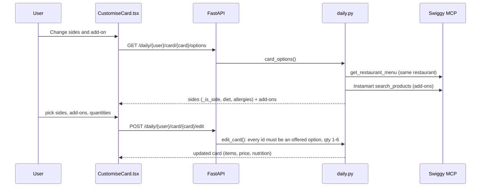

## Meal-time reminders flow

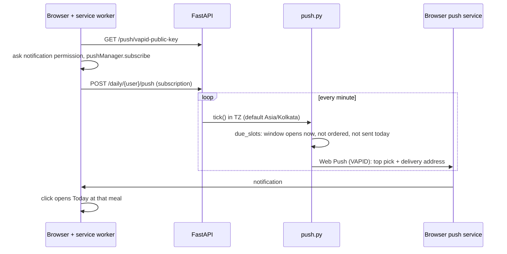

Subscriptions whose endpoint answers 404 or 410 are deleted. VAPID keys come from
`VAPID_PUBLIC_KEY` / `VAPID_PRIVATE_KEY`, or are generated once into `backend/.vapid.json`.

---

## Ordering safety

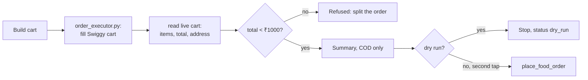

- **Cart only (dry run) is the default.** It builds your real Swiggy cart and stops before
  ordering. Another card of the same meal can replace that cart; nothing is spent.
- **Real orders** need a second, explicit confirmation to switch on. A placed order closes
  the meal: no second order for it.
- Before the final tap, every order shows a summary from Swiggy's live cart: items,
  amount to pay, delivery address and payment (cash on delivery).
- Carts at ₹1000 or more are refused, as Swiggy requires (`backend/order_executor.py`).
- Payment is cash on delivery only.
- Each order goes to the address chosen for it. Only loopback requests may pass an
  `address_id`; a request from the internet cannot redirect an order.
- On a shared server, visitors from the internet cannot switch on Live ordering at all.
- "Powered by Swiggy" / "Powered by Instamart", with the official logos, appear on every
  card, the order summary and the confirmation.

---

## Architecture

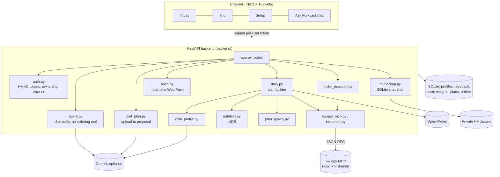

### Plan pipeline

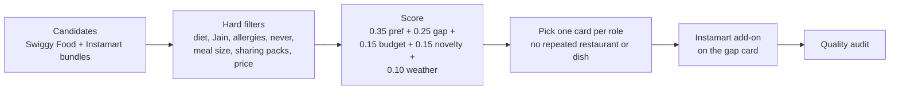

### Building a day
1. **Candidates.** Dishes from Swiggy Food for your address, plus a few Instamart
   bundles (curd + banana, makhana + chaas).
2. **Hard filters.** Diet, Jain rules, allergies, "never" items, meal size, sharing
   portions, price ceiling. These are filters, never weights: a favourite dish does not
   get past an allergy.
3. **Score.**
   `0.35·preference + 0.25·nutrient gap + 0.15·budget fit + 0.15·novelty + 0.10·weather`
4. **Roles.** The best card for each role is picked, without repeating a restaurant or dish.
5. **Add-on.** An Instamart add-on on the gap card, if it closes a real gap. Sides and
   add-ons can be changed per card afterwards.
6. **Quality check.** The finished day is audited: not-a-meal, curry without roti or rice,
   oversized side, Jain-unsafe, duplicates, too small, odd add-on. `GET /daily/{user}/quality`
   returns the result, and the nightly job logs it.

### Nightly job
Refreshes the Swiggy token, pulls new Swiggy orders into the taste profile, recomputes
weights and builds tomorrow's plan, so the morning page loads straight away.

### Where AI is used, and where it isn't
Gemini classifies dish names, reads uploaded diet plans and powers chat. The plan itself
comes from deterministic Python, so it cannot invent dishes, prices or cart IDs. Without
a Gemini key the app still runs on keyword rules.

### Swiggy MCP usage
Food: `get_addresses`, `search_restaurants`, `search_menu`, `get_restaurant_menu`,
`update_food_cart`, `get_food_cart`, `place_food_order`, `track_food_order`,
`get_food_orders`. Instamart: `search_products`, `update_cart`, `get_cart`, `checkout`,
`get_orders`. Menus are cached for the day, `Retry-After` is honoured on HTTP 429, and
errors Swiggy returns inside a successful response are raised, not ignored.

---

## Tech stack

| Layer | Used |
|---|---|
| Web | Next.js 16, React, TypeScript, Tailwind |
| API | Python 3.11, FastAPI, uvicorn |
| Storage | SQLite |
| Food data and ordering | Swiggy MCP (Food + Instamart), OAuth 2.1 + PKCE |
| AI (optional) | Gemini for dish classification, diet-plan reading, chat |
| Nutrition | Indian Nutrient Databank |
| Weather | Open-Meteo |
| Reminders | Web Push (VAPID) |

---

## Run it locally

Requirements: Python 3.11+ and Node.js 20+.

**Windows:** double-click `start.bat`. It starts the backend and the website in two
windows, **Forkcast backend** and **Forkcast website**, waits until both answer, then
opens http://localhost:6001 in your browser. The first run also installs what's missing
(the backend's Python packages, into `backend\.venv` if your Python doesn't have them,
and the website's packages), which takes a few minutes. If a server fails, its window
stays open with the error. To stop Forkcast, close the two windows. Running `start.bat`
again while they are open reuses them.

**macOS / Linux:** run `./start.sh`. It does the same first-run installs and runs both
servers in that terminal. Open http://localhost:6001; Ctrl+C stops both.

**By hand**, in two terminals (the same commands work in PowerShell, cmd and bash).

Backend:

```
cd backend
python -m pip install -r requirements.txt
python -m uvicorn app:app --port 8343
```

Website:

```
cd web
npx --yes pnpm@12 install
npm run dev -- --port 6001
```

`npx --yes pnpm@12 install` is only needed the first time. If `python` isn't found, use
`py -3` on Windows or `python3` on macOS and Linux; if pip there refuses with
"externally-managed-environment", first run `python3 -m venv .venv` and
`source .venv/bin/activate` in `backend`. If Windows PowerShell says running scripts is
disabled, type `npm.cmd` and `npx.cmd` instead.

Then open http://localhost:6001, tap **Connect Swiggy** and sign in on Swiggy's own page.
Without a Swiggy login the app runs on a built-in demo catalogue. After a restart the
live catalogue takes about three minutes to load. The website calls the backend at
http://localhost:8343; `NEXT_PUBLIC_API_URL` is only needed when the backend runs
somewhere else.

First run walks through three steps: connect Swiggy, name and delivery address, then
diet, allergies, budget and favourite dishes.

## Deploy

Chosen hosting ([`docs/DEPLOY-HF.md`](docs/DEPLOY-HF.md)):

- **Backend:** free Hugging Face Docker Space. Free Spaces lose their disk on restart, so
  `backend/hf_backup.py` restores the SQLite DB from a private HF dataset at boot and
  uploads a snapshot every `HF_BACKUP_MINUTES` (default 15) and on shutdown.
- **Website:** Vercel, with `NEXT_PUBLIC_API_URL` set to the Space URL and
  `FORKCAST_ORIGINS` on the Space set to the Vercel URL.
- **Keep-alive:** UptimeRobot calls `GET /ping` every 5 minutes so the Space doesn't sleep.

Alternatives: [`docs/DEPLOY.md`](docs/DEPLOY.md) (Oracle Cloud VM, systemd + Caddy from
`deploy/`) and [`docs/DEPLOY-GCP.md`](docs/DEPLOY-GCP.md) (Google Cloud).

## Configuration

Settings live in `backend/.env` (never committed; see `backend/.env.example`).

| Variable | Purpose |
|---|---|
| `GEMINI_API_KEY` | Dish classification, diet-plan reading and chat. Optional. |
| `SWIGGY_MODE` | `mcp` for live Swiggy, `mock` for the demo catalogue. |
| `SWIGGY_MCP_TOKEN` / `SWIGGY_REFRESH_TOKEN` / `SWIGGY_CLIENT_ID` | Written by **Connect Swiggy** (OAuth 2.1 + PKCE). |
| `SWIGGY_ADDRESS_ID` | Optional: pin a saved Swiggy address. |
| `FORKCAST_SECRET` | Signs user tokens. If unset, a random secret is generated into `backend/.auth_secret`. |
| `FORKCAST_ORIGINS` | Comma-separated web origins allowed to call the API (default `http://localhost:6001,http://localhost:3000`). |
| `FORKCAST_ALLOW_LIVE` | `1` lets visitors from the internet switch on Live ordering. Leave unset while the server holds one shared Swiggy login. |
| `DAILY_NIGHTLY_HOUR` | Hour the nightly job runs (default 2). |
| `VAPID_PUBLIC_KEY` / `VAPID_PRIVATE_KEY` / `VAPID_SUBJECT` | Web Push keys. If unset, generated once into `backend/.vapid.json`. |
| `HF_TOKEN` / `HF_BACKUP_REPO` | Turn on SQLite backup to a private Hugging Face dataset. Both are needed. |
| `HF_BACKUP_MINUTES` | Backup interval (default 15). |
| `TZ` | Time zone for reminders (default `Asia/Kolkata`). |
| `GEMINI_MODEL` | Override the Gemini model. |
| `GEMINI_SEARCH_MODELS` | Models tried, in order, for Google-grounded place lookups in chat (default `gemini-2.5-flash,gemini-3.5-flash-lite`: grounding has its own quota per model). |
| `NEXT_PUBLIC_API_URL` | (web) Backend URL the website calls. |

## API routes

**public**: no token. **user**: the signed token for the user in the path, plus an
ownership check on any card, plan or slot (middleware in `backend/auth.py`).
**loopback**: only from 127.0.0.1 with no proxy headers.

| Method | Path | Auth |
|---|---|---|
| GET | `/ping` | public |
| POST | `/user` | public |
| GET | `/mode` | public |
| POST / GET | `/auth/swiggy/start`, `/auth/swiggy/status` | public |
| POST | `/auth/swiggy/logout` | loopback |
| GET | `/mcp/addresses`, `/mcp/tools`, `/im/search` | public |
| GET | `/push/vapid-public-key` | public |
| GET | `/daily/quiz` | public |
| POST | `/daily/nightly` | loopback |
| GET / POST | `/daily/{user}/profile` | user |
| GET | `/daily/{user}/today` | user |
| POST | `/daily/{user}/regenerate` | user |
| GET | `/daily/{user}/card/{card}/options` | user |
| POST | `/daily/{user}/card/{card}/edit` | user |
| POST | `/daily/{user}/order/{card}` (`?preview=true` builds the cart only) | user |
| POST | `/daily/{user}/feedback`, `/daily/{user}/log` | user |
| GET | `/daily/{user}/quality` | user |
| GET / POST | `/daily/{user}/memory` | user |
| POST | `/daily/{user}/agent` | user |
| POST | `/daily/{user}/diet-plan`, `/daily/{user}/diet-plan/apply` | user |
| POST / DELETE | `/daily/{user}/push` | user |
| DELETE | `/daily/{user}` | user |

Routes from the earlier budget-plan flow (`/plan`, `/slot/...`, `/wallet/...`, `/chat`,
`/intake`, `/appetite`, `/address`) are still in `backend/app.py` and need a token.

## Data model

SQLite; schema in `backend/db.py`.

| Table | Holds |
|---|---|
| `user_profile` | Diet, weekday overrides, allergies, goal, budget, meal windows |
| `daily_menu` / `menu_card` | One plan per user per day and its cards (role, items, sides, add-ons, price, nutrition) |
| `excluded_card` | Dishes hidden for allergies ("Hidden for your allergies") |
| `feedback_event` | Likes, skips, never, ratings, orders |
| `pref_weight` | Learned taste weights |
| `consumption_log` | Meals logged as eaten elsewhere or skipped |
| `order_record` | Orders built or placed through Forkcast |
| `push_subscription` | Web Push endpoints, per user and device |
| `nutrition_ref` | Cached nutrition lookups |
| `users`, `budget_cycles`, `ledger_transactions`, `appetite_profiles`, `plans`, `meal_slots`, `notifications` | Earlier budget-plan flow |

## Tests

```bash
cd backend && python -m pytest -q      # 289+ tests
cd web && npx tsc --noEmit -p .        # type check
```

The backend tests cover card options and edits, the planner rules, allergies, portions, the quality check,
nutrition lookups, learning signals, rollover, weather, diet-plan upload, the order flow
against a fake Swiggy, reminders, and access control.

## Security and privacy

- Every user-scoped route needs that user's signed token (HMAC-SHA256, 30-day sliding
  expiry) and checks that it owns the user, plan or slot in the request.
- The API only accepts browser calls from the listed origins.
- Swiggy tokens stay on the server, never in the browser.
- Stored: preferences, feedback, the plans shown, and orders placed through Forkcast.
  Not stored: payment details, the full street address, uploaded diet-plan files.
- Sent to Gemini: dish names, chat messages and an uploaded diet plan. Never Swiggy
  tokens, addresses or order IDs.

## Repository map

| Path | What |
|---|---|
| `backend/` | FastAPI app, planner, Swiggy clients, tests |
| `backend/data/indb.csv` | Indian Nutrient Databank recipes used for nutrition |
| `web/` | Next.js app: Today, You, setup and chat |
| `deploy/` | systemd unit and Caddy config for the server |
| `docs/SPEC-daily-personalization.md` | Product spec for the daily recommender |
| `docs/PRODUCTION-APPLICATION.md` | Answers for Swiggy's production access form |
| `docs/DEPLOY-HF.md` | Chosen hosting: Hugging Face Space + Vercel + UptimeRobot |
| `docs/DEPLOY.md`, `docs/DEPLOY-GCP.md` | Alternative hosting: Oracle Cloud VM, Google Cloud |

## Known limits

- **One Swiggy login per server.** Everyone using a deployment shares one Swiggy
  account. Per-user Swiggy OAuth needs production access from Swiggy; until then Live
  ordering stays off for internet visitors.
- **Reminders need HTTPS** (localhost is allowed for development) and a browser with Web Push.
- **Free HF Space restarts.** The disk is wiped on restart; anything since the last
  backup (up to 15 minutes) can be lost, and the Space sleeps without the `/ping` monitor.
- **Diet plans map to presets.** Exact calorie or protein numbers from a plan are turned
  into the nearest goal (lose, maintain, gain, high protein), not stored as targets.
- **Nutrition is an estimate.** Restaurant portions differ from reference recipes.
- **Not medical advice.** Medical conditions (diabetes, blood pressure, PCOS, pregnancy)
  are not handled. Allergen information is estimated per dish: always tell the
  restaurant about a severe allergy yourself.

## Team

Vardan Agarwal and Jatin Tilwani.

## Credits

- Food and grocery data: [Swiggy MCP](https://mcp.swiggy.com/builders). Swiggy and
  Instamart logos are used for attribution only.
- Nutrition: Indian Nutrient Databank (Vijayakumar et al., *Current Developments in
  Nutrition*, 2024, [doi:10.1016/j.cdnut.2024.103790](https://doi.org/10.1016/j.cdnut.2024.103790)).
- Weather: [Open-Meteo](https://open-meteo.com).
